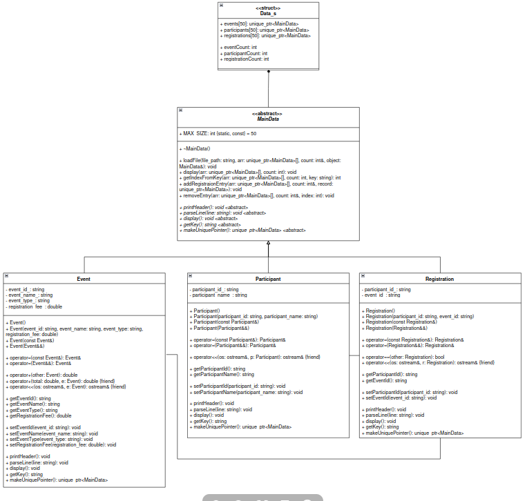

_This project is made by 0135347 yee shun qi for the advanced programming course within UOW_

# Event Registration and Ticket Management System
## Objective
Using oop concpets and principles develop a C++ application for an event registration and ticket management system 

The system is designed to :
- Manage events, participants and registrations through text files. 
- Allow users to view available events, manage participant information, register participants for events, cancel registrations and generate registration reports.

## System Overview
### Part A
---
#### Requirements : 
This following section breaks down the requirements of the project: 

1. Event Management : 
	- Open and read Event.txt.
		- Event.txt format :
		``` text
			eventId;eventName;eventType;registrationFee
		```
		- Event.txt sample information:
		``` text
			E001;C++ Workshop;Workshop;150
			E002;AI Seminar;Seminar;100
		```
	- Parse event information using the `;` delimiter.
	- Data_s event information using arrays or lists for event ID, event name, event type and registration fee.
	- Display available events into the terminal

2. Participant Management:
    - Open and read Participant.txt.
        - Participant.txt format:
		```text
            participantId;participantName
		```
        - Participant.txt sample information:
		```text
            P001;Ali Hassan
            P002;Siti Nurhaliza
		```
	- Parse event information using the `;` delimiter.
    - Data_s participant records using arrays or lists for participant ID and participant name.
    - Display participant records to terminal.

3. Registration Management:
    - Open and read Registration.txt.
        - Registration.txt format:
		```text
            participantId;eventId
		```
        - Registration.txt sample information:
		```text
            P001;E001
            P002;E002
		```
	- Parse event information using the `;` delimiter.
    - Data_s registration records using arrays or lists.
    - Allow participants to register for events.
    - Allow users to cancel existing registrations.
    - Prevent duplicate registrations.
    - Allow one participant to register for multiple events.

4. Reporting Functions:
    - Generate reports based on the stored registration information.
    - Display a list of participants registered for a particular event.
    - Display the registration summary for a participant.
    - Calculate the total number of registrations for each event.
    - Calculate the total registration fees collected for each event.

#### Implementation :

### Part B 
---
## How the requirements are implemented :

1. **Runtime Polymorphism:** Implement virtual functions and demonstrate runtime polymorphism through base class pointers or references.
   - `MainData` has virtual functions that are overridden by `Event`, `Participant` and `Registration`.
   - The record arrays store `std::unique_ptr<MainData>`. Calling `display()` or `parseLine()` through these pointers runs the matching object's function.

2. **Constructor Overloading:** Provide overloaded constructors where appropriate.
   - The record classes have default and parameterized constructors. 
   - The default constructors are used when loading records. The parameterized `Registration` constructor is used when a registration is added.

3. **Operator Overloading:** Implement at least one meaningful operator overloading function. Examples may include registration comparison, fee calculation, participant statistics.
   - `Event` overloads `operator+` to add registration fees in the reports. The classes also overload `operator<<` to display data.
   - `Registration` has an `operator==` to compare registrations, but the program currently checks duplicates using `getKey()`.

4. **Friend Functions:** Implement at least one meaningful friend function.
   - The record classes declare `operator<<` as a friend so it can access private data when displaying an object since displaying to the output invovles using the output strema
   -`Event` also has a friend `operator+` for adding a fee to a total.

5. **Exception Handling:** Use exception handling to manage situations such as invalid event ID, invalid participant ID, duplicate registration, and file processing errors.
   - The program throws errors for missing files, invalid file rows, duplicate records, and unknown event or participant IDs. `try`/`catch` blocks display errors without stopping the menu.

6. **File Processing:** The application shall read information from the provided text files and save modifications back to files when required.
   - `MainData::loadFile()` reads and parses the event, participant and registration files.
   - Modification will be made to the registration file if cancellations and registrations are made

7. **Modern C++:** Use modern C++ features.
	Following are some examples of the feature in my code : 
	- Smart pointers: `std::unique_ptr`, `std::make_unique`.
	- Uniform initialization: `double registration_fee_{};`
	- References: `registerParticipant(Data_s& data_struct)`, `const std::string&`.
	- Moves: `std::move` transfers strings and `std::unique_ptr` ownership.
	- Defaulted functions: `= default` for constructors, destructors, and copy/move operations.
	- Member initializer lists: used in constructors.
	- Trailing underscores: private fields, e.g. `participant_id_`.
	- `noexcept`: declared on defaulted move operations.
	- `virtual` and `override`: used for runtime polymorphism.
	- `const`: used for getters and read-only parameters.
	- `[[nodiscard]]`: used for getters 

### Files - Role of each source file
--- 
#### File structure :

```text
	Assignment_2/
	├── Includes/
	│   ├── MainData.hpp
	│   ├── Event.hpp
	│   ├── Participant.hpp
	│   ├── Registration.hpp
	│   └── header.hpp
	├── ClassSources/
	│   ├── MainData.cpp
	│   ├── Event.cpp
	│   ├── Participant.cpp
	│   └── Registration.cpp
	├── Sources/
	│   ├── MenuFeatures.cpp
	│   ├── HelperFunctions.cpp
	│   ├── ManageRegistraions.cpp
	│   └── GenerateReport.cpp
	├── Main/
	│   └── driver.cpp
	├── Event.txt
	├── Participant.txt
	├── Registration.txt
	├── Makefile
	├── README.md
	└── ClassDiagramBasic.png
```

#### File roles : 

1. Includes :
   1. MainData.hpp : Declares the abstract and base class
   2. Event.hpp : Declares the Event class inheriting from MainData 
   3. Participant.hpp : Declares the Participant class inheriting from MainData 
   4. Registration.hpp : Declares the Registration class inheriting from MainData 
   5. header.hpp : Includes all the header files of each objeacts, function prototypes from all the files and the required include libraries

2. ClassSources :
   1. MainData.cpp : Contains the functions used by all the objects to load data from files, display records, search for records, add records and remove records.
   2. Event.cpp : Contains the functions for the Event class, including parsing event data, displaying event records and calculating registration fees.
   3. Participant.cpp : Contains the functions for the Participant class, including parsing participant data and displaying participant records.
   4. Registration.cpp : Contains the functions for the Registration class, including parsing and displaying registrations and creating the registration key.

3. Sources :
   1. MenuFeatures.cpp : Contains function directly used by the main loop like display menu option and to read user input passed int menu.
   2. HelperFunctions.cpp : Contains lookup functions to find events, participants and registrations, and checks that loaded registrations use valid IDs.
   3. ManageRegistraions.cpp : Contains the functions for registering participants for events and cancelling registrations.
   4. GenerateReport.cpp : Contains the functions that generate reports about event participants, participant registrations and event totals and fees.

4. Main :
   1. driver.cpp : Contains `int main` that runs the menu loop 

5. Root files :
   1. Makefile : A makefile used to compile all the source files to run together easily uisng `make`
   2. README.md : The current file for documation
   3. ClassDiagramBasic.png : class diagram 

### Compilation guide
---
Due to the volume of source files (.cpp), a Makefile has been created to compile into a executionable file.

The input files should be placed in the project root folder alongside `README.md`.

```c++
	MainData::loadFile("./Event.txt", data.events, data.eventCount, Event{});
	MainData::loadFile("./Participant.txt", data.participants, data.participantCount, Participant{});
	MainData::loadFile("./Registration.txt", data.registrations, data.registrationCount, Registration{});        
```

Then run : 
```bash
	make
```
Check the `PHONY.` values for other capabilities :

These targets are declared as `.PHONY` in the Makefile. This tells `make` that `all`, `clean`, `fclean`, and `re` are command names, not files, so the commands still run even if a file with one of those names exists.

These are implemented for me to use during development in the case of recompilation and object file deletion, to compile only use make. However if code is changed after compiling , run `make re` to recompile the file. 

Lastly to run the program do : 
```bash
	./event_management_system
```

## Design (Class Diagram)
### Basic Class Diagram w/ Classes Only

- This diagram states all the classes only and does not include the helper funciton needed for the program. (The helper funciton to run the main are deliberately exculeded as this is sufficient to demonstrate the requirements defined in the assignment rubrics and adding more detail will flood up the image)

Abstraction : 
- Functions that are marked with virtual are an abstract class are dednoted with `<absrtact>` and intallicized.
- The virtual funcitons are abstract because no function body is written and it has to be defined by child classes, they include `printHeader`, `parseLine`, `display`, `getKey`, `makeUniquePointer`

Inheritance :
- `Event` is-a MainData
- `Participant` is-a MainData
- `Registration` is-a MainData
- Each child overrides the five abstract functions, and inherits the other utility functions as is.

Composition :
- `Data_s` is made up of `MainData` , `MainData` is a parent class of all the other classes therefore this relationship is applied.
- `Data_s` owns three arrays of unique_ptr<MainData>, so the records are destroyed when it is destroyed.

Encapsulation :
- All the fields in Event, Participant and Registration are private denoted by(-) and can only be reached through public getters and setters (+).

Association : 
- `Registration` is required to refer to `Event` and `Participant` to access events and participant records.

Polymorphism :
- This is not directly shown in the class diagram, `Data_s` stores base-class pointers, so a call such as arr[i]->display() runs the version of the called object (Event, Participant or Registration).

## Reference list [IEEE referencing]
Some of the topics were covered in class; however, for my own future reference, some of those concepts will be referred to here.

### 1. Exception handling
- In my program, I did not override the `what()` function for exception handling because I used `std::runtime_error` for the errors instead.

	References:

	[1] cppreference.com, "std::runtime_error," cppreference.com, [Online]. Available: https://en.cppreference.com/w/cpp/error/runtime_error [Accessed: 2 Nov. 2026].

	[2] GeeksforGeeks, "How to Throw an Exception in C++?," GeeksforGeeks, [Online]. Available: https://www.geeksforgeeks.org/cpp/how-to-throw-an-exception-in-cpp/ [Accessed: 2 Nov. 2026].

	[3] GeeksforGeeks, "Exception Handling in C++," GeeksforGeeks, [Online]. Available: https://www.geeksforgeeks.org/cpp/exception-handling-c/ [Accessed: 2 Nov. 2026].

	[4] cppreference.com, "std::out_of_range," cppreference.com, [Online]. Available: https://en.cppreference.com/w/cpp/error/out_of_range [Accessed: 3 Nov. 2026].

### 2. Standard error (`std::cerr`)
- Tried to print errors in a more formal manner by outputting them to the standard error stream rather than the standard output stream.

	References:

	[5] GeeksforGeeks, "cerr Standard Error Stream Object in C++," GeeksforGeeks, [Online]. Available: https://www.geeksforgeeks.org/cpp/cerr-standard-error-stream-object-in-cpp/ [Accessed: 3 Nov. 2026].

### 3. Abstract classes and pure virtual functions
- The `MainData` class is used as an abstract class to ensure that the derived classes follow the structure defined in it while having their own implementations.

	References:

	[6] GeeksforGeeks, "Pure Virtual Functions and Abstract Classes in C++," GeeksforGeeks, [Online]. Available: https://www.geeksforgeeks.org/cpp/pure-virtual-functions-and-abstract-classes/ [Accessed: 2 Nov. 2026].

	[7] cppreference.com, "Abstract class," cppreference.com, [Online]. Available: https://en.cppreference.com/w/cpp/language/abstract_class [Accessed: 2 Nov. 2026].

### 4. Virtual functions and `override`
- I am aware of how virtual functions allow runtime polymorphism, but the concepts of abstract classes were not that clear. My implementation required a parent class and derived classes that follow the parent class while having their own implementations, especially for functions such as `display()` and `parseLine()`.

	References:

	[8] Stack Overflow, "C++ virtual keyword vs overriding function," Stack Overflow, [Online]. Available: https://stackoverflow.com/questions/45357671/c-virtual-keyword-vs-overriding-function [Accessed: 3 Nov. 2026].

	[9] Kenny Yip Coding, "C++ Virtual Functions and Override," YouTube, [Online]. Available: https://www.youtube.com/watch?v=lWvq8nSQs_M [Accessed: 3 Nov. 2026].

### 5. Operator overloading and friend functions
- `operator+` is used for fee calculations in the `Event` class. I also referred to friend functions to understand how operator overloading works when accessing private class members.
- What I learnt is that without `friend`, the lhs variable must be a class object but `cout` is not. Given that we need to pass in an `Event` object which contains private fields, the operation is made into a friend function so `cout`, which is the stream, can be passed as a parameter instead.

	References:

	[10] GeeksforGeeks, "Operator Overloading in C++," GeeksforGeeks, [Online]. Available: https://www.geeksforgeeks.org/cpp/operator-overloading-cpp/ [Accessed: 3 Nov. 2026].

	[11] cppreference.com, "Operator overloading," cppreference.com, [Online]. Available: https://en.cppreference.com/w/cpp/language/operators [Accessed: 3 Nov. 2026].

	[12] Learn C++, "Overloading the arithmetic operators using friend functions," Learn C++, [Online]. Available: https://www.learncpp.com/cpp-tutorial/overloading-the-arithmetic-operators-using-friend-functions/ [Accessed: 4 Nov. 2026].

	[13] r/cpp_questions, "Operator overloading as friend function in class," Reddit, [Online]. Available: https://www.reddit.com/r/cpp_questions/comments/jsncod/operator_overloading_as_friend_function_in_class/ [Accessed: 4 Nov. 2026].

	[14] Stack Overflow, "Friend functions and operator overloading: what is the proper way to overload an operator for a class?," Stack Overflow, [Online]. Available: https://stackoverflow.com/questions/2828280/friend-functions-and-operator-overloading-what-is-the-proper-way-to-overlo [Accessed: 4 Nov. 2026].

	[15] GeeksforGeeks, "Different Ways of Operator Overloading in C++," GeeksforGeeks, [Online]. Available: https://www.geeksforgeeks.org/cpp/different-ways-of-operator-overloading-in-cpp/ [Accessed: 4 Nov. 2026].

### 6. Orthodox Canonical Form / Rule of Zero / Three / Five
- The classes in the program were initially written based on Orthodox Canonical Form (constructor, destructor, copy constructor and copy assignment); this was due to my attempt to implement operator overloading and function overloading. Additionally, I implemented move constructors and move assignment operators with `noexcept`. This was to demonstrate my understanding of how accessors, mutators, `const`, `[[nodiscard]]`, copy constructors, move constructors and copy assignment work based on what was taught during lectures.
- However, they were made during the initialization of classes only; as the program developed, I realised that many of these functions were not actually being used.
- Instead of deleting my work, I came across the Rule of Zero, Three and Five. The C++ Rule of Five (introduced in C++11) states that if a class explicitly defines or deletes any one of the five special member functions managing a resource, it should explicitly define or delete all five.
- Therefore, with that reasoning and the reasoning to keep what I implemented as a learning attempt.

	References:

	[16] cppreference.com, "The rule of three/five/zero," cppreference.com, [Online]. Available: https://en.cppreference.com/w/cpp/language/rule_of_three [Accessed: 4 Nov. 2026].

	[17] Stack Overflow, "When is noexcept required on move assignment?," Stack Overflow, [Online]. Available: https://stackoverflow.com/questions/74375099/when-is-noexcept-required-on-move-assignment [Accessed: 4 Nov. 2026].

### 7. `std::move`
- Mainly referred to for a deeper understanding of how move constructors work and how memory management works when `std::move` is used instead of copying.

	References:

	[18] cppreference.com, "std::move," cppreference.com, [Online]. Available: https://en.cppreference.com/w/cpp/utility/move [Accessed: 5 Nov. 2026].

	[19] cppreference.com, "Move constructors," cppreference.com, [Online]. Available: https://en.cppreference.com/w/cpp/language/move_constructor [Accessed: 5 Nov. 2026].

	[20] Microsoft, "Move Constructors and Move Assignment Operators (C++)," Microsoft Learn, [Online]. Available: https://learn.microsoft.com/en-us/cpp/cpp/move-constructors-and-move-assignment-operators-cpp?view=msvc-170 [Accessed: 5 Nov. 2026].

	[21] S. Tiset, "Move to Move Constructor in C++," Medium, [Online]. Available: https://medium.com/@sylvain.tiset/move-to-move-constructor-c-dd03f94005e0 [Accessed: 5 Nov. 2026].

### 8. Smart pointers (`std::unique_ptr` and `std::make_unique`)
- Records are stored using `std::unique_ptr` and created using `std::make_unique`. I also referred to the `reset()` function to understand how to release ownership when removing an entry from an array.

	References:

	[22] GeeksforGeeks, "unique_ptr in C++," GeeksforGeeks, [Online]. Available: https://www.geeksforgeeks.org/cpp/unique_ptr-in-cpp/ [Accessed: 4 Nov. 2026].

	[23] cppreference.com, "std::unique_ptr<T,Deleter>::reset," cppreference.com, [Online]. Available: https://en.cppreference.com/w/cpp/memory/unique_ptr/reset [Accessed: 4 Nov. 2026].

	[24] cplusplus.com, "unique_ptr::reset," cplusplus.com, [Online]. Available: https://cplusplus.com/reference/memory/unique_ptr/reset/ [Accessed: 4 Nov. 2026].

### 9. `setw()`
- Primarily used in display functions such as the menu and reports. The sources were mainly referred to as a refresher on how to use the syntax.

	References:

	[25] GeeksforGeeks, "setw() function in C++ with Examples," GeeksforGeeks, [Online]. Available: https://www.geeksforgeeks.org/cpp/setw-function-in-cpp-with-examples/ [Accessed: 7 Nov. 2026].

### 10. `stoi` / `stod`
- Used to understand how string values can be converted into numerical values. In my program, `std::stoi` is used for menu input while `std::stod` is used for registration fees.

	References:

	[26] GeeksforGeeks, "std::stoi() function in C++," GeeksforGeeks, [Online]. Available: https://www.geeksforgeeks.org/cpp/stdstoi-function-in-cpp/ [Accessed: 8 Nov. 2026].

### 11. Naming conventions for C++ classes
- Sources and lecture slides from class were referred to for naming conventions.

	References:

	[27] r/cpp_questions, "Modern C++ naming conventions," Reddit, [Online]. Available: https://www.reddit.com/r/cpp_questions/comments/6vhfet/modern_c_naming_conventions/ [Accessed: 8 Nov. 2026].

	[28] Google, "Google C++ Style Guide: Naming," Google, [Online]. Available: https://google.github.io/styleguide/cppguide.html#Naming [Accessed: 8 Nov. 2026].

### 12. Makefile
- I personally had experience creating Makefiles from other external projects. Therefore, this reference is a mix of my own knowledge and examples from this guide, which I found particularly useful.

	References:

	[29] makefiletutorial.com, "Makefile Tutorial by Example," makefiletutorial.com, [Online]. Available: https://makefiletutorial.com/ [Accessed: 9 Nov. 2026].

### 13. lvalue and rvalues
- cppreference and online guides constantly mention rvalues and lvalues. Essentially:
	- lvalue is a memory location that identifies the object
	- rvalue is the data value stored at the addresses
		```cpp
			int x = 5;        // x is an lvalue, 5 is an rvalue
			// therefore
			5 = x; // not applicable
		```

	References:

	[30] GeeksforGeeks, "Lvalues, Rvalues and Rvalue References in C++," GeeksforGeeks, [Online]. Available: https://www.geeksforgeeks.org/cpp/lvalues-references-and-rvalues-references-in-c-with-examples/ [Accessed: 9 Nov. 2026].

### 14. Class diagram
- Referred to know how to draw the diagram, represent abstract classes and friend functions.

	References:

	[31] Visual Paradigm, "UML Class Diagram Tutorial," Visual Paradigm, [Online]. Available: https://www.visual-paradigm.com/guide/uml-unified-modeling-language/uml-class-diagram-tutorial/ [Accessed: 9 Nov. 2026].

	[32] Stack Overflow, "How to represent standalone functions calling other standalone functions in UML?," Stack Overflow, [Online]. Available: https://stackoverflow.com/questions/67974550/how-to-represent-standalone-functions-calling-other-standalone-functions [Accessed: 9 Nov. 2026].

	[33] Stack Overflow, "How to present an abstract class in a UML class diagram?," Stack Overflow, [Online]. Available: https://stackoverflow.com/questions/46049761/how-to-present-an-abstract-class-in-uml-class-diagram [Accessed: 9 Nov. 2026].

	[34] Stack Overflow, "How to represent a function method type in a UML class diagram?," Stack Overflow, [Online]. Available: https://stackoverflow.com/questions/77227848/how-to-represent-a-function-method-type-in-a-uml-class-diagram [Accessed: 9 Nov. 2026].


## AI usage
- Menu display : AI was more heavily used to create the formatting for menu outputs and display formatting for all three objects after it was stored in the array (especially for ones involving setw() as it required more precise spacing to ensure the data shows tidily).
- exception error messages : AI assistance was used to create the error messages based on the caught exceptions.
- README : AI was used in README to help with reference formatting, based on the IEEE referencing and formatting for the file tree.
- Classess : Reduntant duplicaiton of implementation or just prototyping for class member funcitons such as accessors , mutators, destructors and copy constructors , move constructors were assisted by ai to speed up the process but base logic for one class was written fully before using this approach. 
- General guidance : It was used to guide me through concepts i was less familiar with which includes explanation and demonstrations of virtual funciton implementations, try catch exceptions and its error messages, unique_pointers and the logic of std::move(). 

If there are doubts on the progress or development on the assignment, view the git logs from my github page : https://github.com/shun2727/Advanced_programming.git